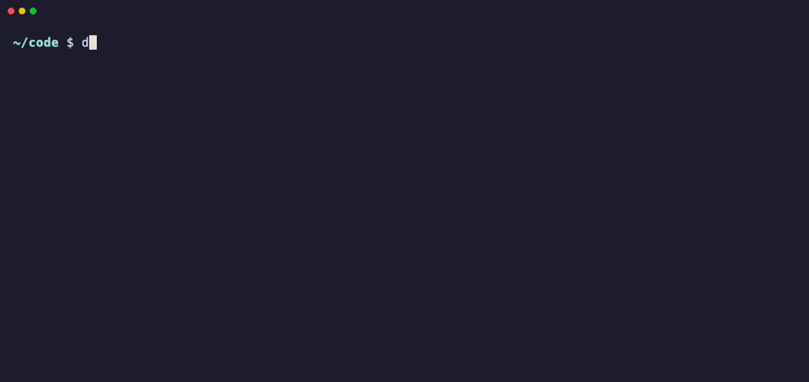

# depclean

**Get disk space back from projects you aren't working on.** `depclean` scans a folder of code, finds the dependency and cache folders that a reinstall brings back (`node_modules`, Python virtualenvs, Rust `target`, build caches, …), shows how much space each project would free, and lets you pick what to remove in a keyboard-driven terminal UI.



- **Safe by design**: it only matches a folder when a marker proves what it is (for example, `target` only next to a `Cargo.toml`, and a virtualenv only if it contains `pyvenv.cfg`). It never follows symlinks, never touches `.git`, and checks each folder again right before deleting it.
- **Fast**: it shows results right away and measures sizes in the background, updating them live.
- **Honest sizes**: it reports real disk usage. Files hard-linked elsewhere (such as pnpm's store) are left out of "reclaimable", because deleting them frees nothing.
- **Finds stale projects**: the MODIFIED column shows when you last touched a project's own files, ignoring dependency folders. Sort by age to see the forgotten ones first.
- **No dependencies**: it uses only the Python standard library (Python ≥ 3.9).

## Install

[](https://pypi.org/project/depclean/)

With [uv](https://docs.astral.sh/uv/):

```bash
uv tool install depclean
```

or with [pipx](https://pipx.pypa.io/):

```bash
pipx install depclean
```

Or try it without installing:

```bash
uvx depclean ~/code
```

To get the latest unreleased version, install from GitHub instead: `uv tool install git+https://github.com/magnumnighthawk/depclean`.

It's tested on macOS and Linux. On Windows it should work through `windows-curses`, which is installed automatically, but that hasn't been tested.

## Usage

```bash
depclean                 # scan the current folder
depclean ~/code          # scan a specific folder
depclean --list ~/code   # just print a report, never deletes
depclean --json ~/code   # machine-readable report
```

| Option | |
|---|---|
| `-l, --list` | Print a report and exit. Never deletes. |
| `--json` | Report as JSON (implies `--list`). |
| `--no-size` | Skip size measurement. |
| `-d, --depth N` | How many folder levels to search (default 6). |
| `-x, --exclude GLOB` | Skip matching paths or folder names. Repeatable, e.g. `-x '*/keep-me' -x .tox`. |
| `--force-root` | Allow interactive mode on `/` or your home folder (refused by default). |

### Keys

| Key | Action |
|---|---|
| `↑ ↓` / `j k`, `PgUp PgDn`, `g G` | Move |
| `space` | Select a project (all its folders) or a single folder |
| `a` | Select / clear everything shown |
| `enter` / `→` | Expand a project to pick individual folders |
| `←` | Collapse |
| `s` | Sort by size, age (oldest first) or name |
| `/` | Filter by path or folder name |
| `d` | Delete the selection (asks for confirmation first) |
| `?` | Help |
| `q` / `esc` | Quit |

Deleting is **permanent** (not to the Trash), because a Trash full of `node_modules` frees no space. After deleting, `depclean` shows how much was freed and lists anything it couldn't remove.

## What it removes

| Kind | Folders | Only when | Get it back with |
|---|---|---|---|
| node | `node_modules` | always | `npm` / `pnpm` / `yarn` / `bun install` |
| python venv | any name (`.venv`, `venv`, `env`, …) | the folder contains `pyvenv.cfg` | recreate the venv, then `pip`/`uv`/`poetry install` |
| python cache | `__pycache__`, `.pytest_cache`, `.mypy_cache`, `.ruff_cache`, `.tox`, `.nox` | always | recreated automatically |
| build cache | `.next`, `.nuxt`, `.turbo`, `.parcel-cache`, `.svelte-kit`, `.angular` | always | next build / dev run |
| rust | `target` | next to `Cargo.toml` | `cargo build` |
| cocoapods | `Pods` | next to `Podfile` | `pod install` |
| gradle | `build`, `.gradle` | next to `build.gradle(.kts)` / `settings.gradle(.kts)` | `gradle build` |

It deliberately **does not** remove `dist`, `vendor`, `build` without Gradle, or `target` without Cargo, because those often hold things you can't regenerate.

Results are grouped by project: the nearest enclosing git repository, otherwise the nearest folder with a manifest (`package.json`, `pyproject.toml`, `Cargo.toml`, …).

## Development

```bash
git clone https://github.com/magnumnighthawk/depclean && cd depclean
uv run pytest
uv run ruff check
uv run depclean --list ~/code
```

To re-record the demo GIF, see the header of [`docs/demo.tape`](docs/demo.tape) (needs [vhs](https://github.com/charmbracelet/vhs)).

### Releasing

Pushing a `v*` tag publishes to [PyPI](https://pypi.org/project/depclean/) using trusted publishing and creates a GitHub release (see `.github/workflows/release.yml`). To release:

1. Bump `__version__` in `src/depclean/__init__.py` and add an entry to `CHANGELOG.md`.
2. Commit, then run `git tag vX.Y.Z && git push && git push --tags`.

## License

MIT
